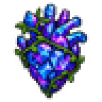
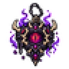
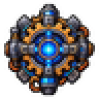
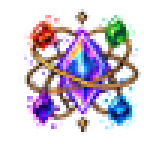

<div align="center">


# HeartSlots

**Четыре реликвии. Четыре слота. Навсегда.**

[](https://www.tmodloader.net/)
[](https://terraria.org/)
[](#-english)
[](#)
[](LICENSE)

</div>

---

## Что это

Небольшой мод для tModLoader, который добавляет **четыре крафтуемых реликвии**. Каждая при
первом использовании **навсегда открывает персонажу +1 слот аксессуаров** и исчезает.

Работает как ванильное Демоническое сердце: предмет одноразовый по эффекту. Скрафтить второй
такой же можно, но использовать его бессмысленно — слот уже открыт, а предмет не потратится.

Слоты **независимы**: любой можно открыть первым, порядок не важен.

---

## Предметы

<table>
<tr>
<td align="center" width="25%">
<br><br>
<b>Кристальное Сердце</b><br>
<sub>Crystal Heart</sub><br><br>
<sub>10 кристаллов жизни<br>10 алмазов<br>10 сапфиров<br>10 аметистов</sub>
</td>
<td align="center" width="25%">
<br><br>
<b>Зловещий Талисман</b><br>
<sub>Ominous Talisman</sub><br><br>
<sub>10 чешуек тени / образцов ткани<br>10 демонита / кримтанита<br>50 костей<br>1 железная / свинцовая наковальня</sub>
</td>
<td align="center" width="25%">
<br><br>
<b>Механический Расширитель</b><br>
<sub>Mechanical Expander</sub><br><br>
<sub>15 хлорофита<br>15 святых слитков<br>5 душ света<br>5 душ ночи<br>1 механический призыватель</sub>
</td>
<td align="center" width="25%">
<br><br>
<b>Небесный Синтезатор</b><br>
<sub>Celestial Synthesizer</sub><br><br>
<sub>20 слитков люминита<br>10 осколков солнца<br>10 осколков вихря<br>10 осколков туманности<br>10 осколков пыли</sub>
</td>
</tr>
</table>

Все рецепты крафтятся на **Демоническом или Багряном алтаре** — это один и тот же тип станции,
так что работает в любом мире.

---

## Установка

### Готовый мод

1. Скачай `HeartSlots.tmod` из папки [`release/`](release).
2. Положи файл в `Documents\My Games\Terraria\tModLoader\Mods\`.
3. Запусти tModLoader → **Mods** → включи **HeartSlots** → **Reload Mods**.

### Сборка из исходников

Нужен **.NET 8 SDK** и установленный tModLoader.

```bash
git clone https://github.com/arimaML/HeartSlots.git
cd HeartSlots/HeartSlots
dotnet build -p:SteamTMLPath="C:\Program Files (x86)\Steam\steamapps\common\tModLoader\"
```

Путь можно не указывать, если tModLoader стоит в стандартном месте — `HeartSlots.csproj`
сам проверяет несколько типовых расположений Steam.

Собранный `.tmod` попадёт в папку модов игры.

Альтернатива: помести папку `HeartSlots` в
`Documents\My Games\Terraria\tModLoader\ModSources\` и собери прямо в игре
(**Mods → Develop Mods → Build & Reload**).

> **Важно:** папка проекта должна называться `HeartSlots` — tModLoader берёт внутреннее имя
> мода именно из имени папки, а от него зависят ключи локализации и пути к текстурам.

---

## Структура

```
HeartSlots/
├── build.txt                     метаданные мода (автор, версия, имя)
├── description.txt               описание для карточки мода
├── HeartSlots.csproj             сборка, найти tModLoader
├── icon.png                      иконка 80×80
├── HeartSlots.cs                 точка входа + сетевые пакеты
├── Common/                       состояние персонажа (флаги слотов, сохранение)
├── Content/
│   ├── HeartSlotsRecipes.cs      рецепты и группы «любой из»
│   ├── Items/                    четыре предмета
│   └── Slots/                    четыре слота аксессуаров
├── Assets/Items/                 спрайты предметов 48×48
└── Localization/                 en-US.hjson, ru-RU.hjson
```

Подробности решений и найденные особенности API — в [`docs/DESIGN.md`](docs/DESIGN.md).

---

## Совместимость

- **tModLoader** 2026.08 (Terraria 1.4.4.9)
- **Recipe Browser** — рецепты подхватываются автоматически, дополнительных действий не нужно
- Одиночная игра и мультиплеер (состояние слотов синхронизируется)

---

## 🇬🇧 English

A small tModLoader mod adding **four craftable relics**. Each one permanently unlocks **one extra
accessory slot** for that character, then is consumed — just like the vanilla Demon Heart.

The four slots are independent, and unlocks are saved with the player.

| Relic | Recipe |
|---|---|
| Crystal Heart | 10 Life Crystals, 10 Diamonds, 10 Sapphires, 10 Amethysts |
| Ominous Talisman | 10 Shadow Scales / Tissue Samples, 10 Demonite / Crimtane Bars, 50 Bones, 1 Iron / Lead Anvil |
| Mechanical Expander | 15 Chlorophyte Bars, 15 Hallowed Bars, 5 Souls of Light, 5 Souls of Night, 1 mechanical summon |
| Celestial Synthesizer | 20 Luminite Bars, 10 of each Celestial Fragment |

All recipes are crafted at a **Demon or Crimson Altar**.

**Install:** grab `HeartSlots.tmod` from [`release/`](release), drop it into
`Documents\My Games\Terraria\tModLoader\Mods\`, then enable the mod in-game and reload.

**Build:** requires the .NET 8 SDK and tModLoader. See the section above.

---

## Лицензия

[MIT](LICENSE) © Arima
